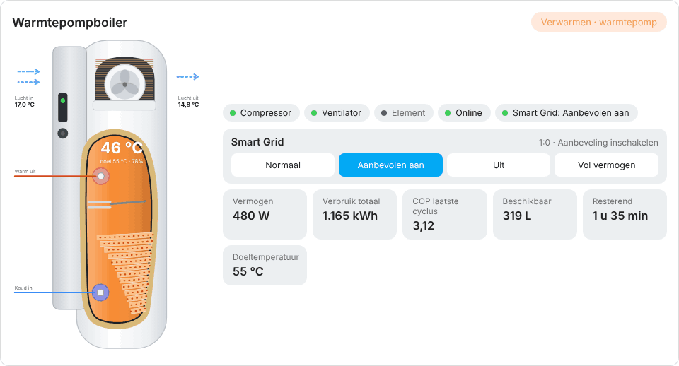
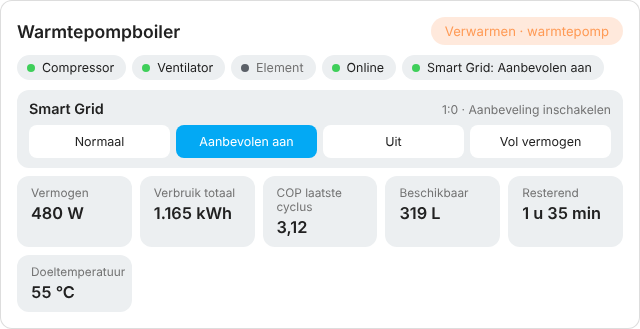
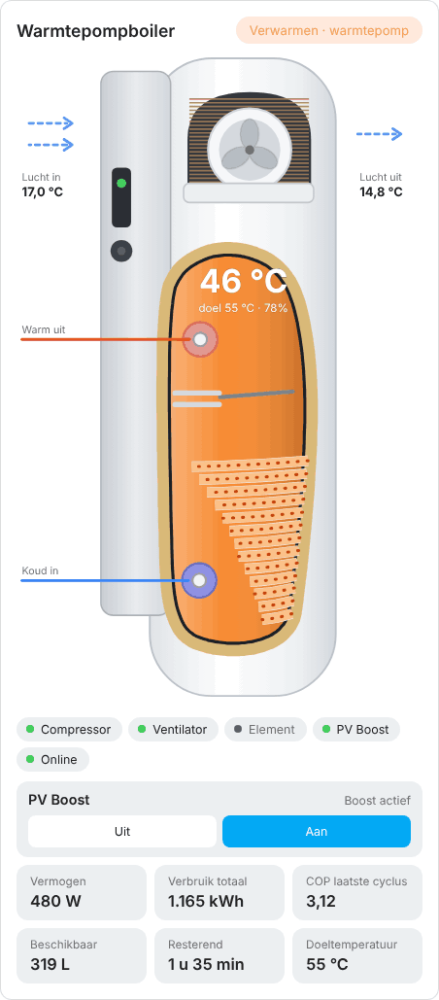

# Atlantic Explorer Card for Home Assistant

🇳🇱 [Nederlandse versie](README.md)

An animated dashboard card for the **Atlantic Explorer V5** heat pump water heater (`custom:atlantic-explorer-card`). The card draws the water heater as a single unit: the heat pump module with evaporator and fan on top, the insulated tank below with the condenser coil. The fan spins, the coil flows, and the water changes from blue to orange with the water temperature.

<p align="center">
  <picture>
    <source media="(prefers-color-scheme: dark)" srcset="images/boiler-dark.gif">
    
  </picture>
</p>

<p align="center"><em>Example with demo values. In Home Assistant the animations follow the live status.</em></p>

The look is inspired by [AMensink/warmtepomp-cards](https://github.com/AMensink/warmtepomp-cards) (MIT). The code was written from scratch. Card labels are in Dutch. Animations stop automatically if your device has "reduce motion" enabled.

Do you have a Panasonic monoblock? There is a separate card for that: `panasonic-monoblock-card`.

---

## Installation

### Via HACS (recommended)

1. Open **HACS** in Home Assistant.
2. Click ⋮ in the top right → **Custom repositories**.
3. Paste the URL of this repository, choose type **Dashboard** and click **Add**.
4. Search for **Atlantic Explorer Card**, click **Download** and reload the browser (Ctrl+F5).

[](https://my.home-assistant.io/redirect/hacs_repository/?owner=Yakfeet&repository=atlantic-explorer-card&category=plugin)

### Manual

1. Download `dist/atlantic-explorer-card.js` and place it in `/config/www/`.
2. Go to **Settings → Dashboards → ⋮ → Resources → Add resource**.
3. URL: `/local/atlantic-explorer-card.js`, type: **JavaScript module**.
4. Reload the browser.

---

## Usage

Edit a dashboard, choose **Add card**, open the card's YAML editor and fill in your own entities under `entities:`. Only what you fill in is shown: missing values, chips and tiles are left out. Click a value in the card to open that entity's details dialog.

```yaml
type: custom:atlantic-explorer-card
title: Warmtepompboiler
min_temp: 15
max_temp: 60
entities:
  tank_temp: sensor.explorer_midden_temp
  setpoint: sensor.explorer_target
  air_in: sensor.explorer_inlaat_temp
  air_out: sensor.explorer_uitblaas_temp
  power: sensor.explorer_vermogen
  energy_total: sensor.explorer_verbruik_totaal
  cop: sensor.explorer_cop_laatste_cyclus
  available_liters: sensor.explorer_38c_geschat
  remaining_minutes: sensor.explorer_38c_resterend
  pv_boost: switch.wpboiler_pv_boost    # input I1 (PV Boost or Smart Grid)
  sg_2: switch.explorer_smart_grid_i2   # input I2, Smart Grid only
```

### Options

| Option | Description | Default |
| --- | --- | --- |
| `title` | Card title | `Warmtepompboiler` |
| `min_temp` | Temperature that counts as "cold" (colour and percentage) | `15` |
| `max_temp` | Temperature that counts as "hot" | `60` |
| `reverse_flow` | Reverses the flow animation in the coil and the air arrows | `false` |
| `image` | Optional: your own cutaway image instead of the drawing, see below | empty |
| `element_power` | Power in W above which the electric element counts as active, if you have no `heater` sensor | 800 |
| `grid_mode` | What input I1 is set to on the water heater: `smart_grid` or `pv_boost`, see below | automatic |

### Entities

| Key | Meaning |
| --- | --- |
| `water_heater` | `water_heater` entity (e.g. via Overkiz/Cozytouch). Used for temperature, target and mode when the separate sensors are missing |
| `tank_temp` | Water temperature in the middle of the tank |
| `tank_top` / `tank_bottom` | Top and bottom of the tank, if you have those sensors |
| `setpoint` | Target temperature |
| `air_in` / `air_out` | Air temperature before and after the evaporator |
| `coil` / `exhaust` / `return_gas` | Evaporator, discharge gas and suction gas temperature |
| `eev` | Expansion valve position |
| `power` | Electrical power (W) |
| `energy_today` / `energy_month` / `energy_total` | Energy used today / this month / in total (kWh) |
| `cop` | COP of the last cycle |
| `available_liters` | Available hot water (L) |
| `remaining_minutes` | Remaining hot water time (min) |
| `runtime_defrost` | Run time until the next defrost (min) |
| `pv_boost` | Switch of input I1: PV Boost, or input I1 when used for Smart Grid |
| `sg_1` | Only needed if I1 is wired to a different switch than `pv_boost`. Otherwise leave it out |
| `sg_2` | Switch of input I2 (Smart Grid only) |
| `compressor` | Heat pump active on/off. Without it, "active" is derived from power (> 50 W) |
| `heater` | Electric element on/off. Without it, "active" is derived from power (> `element_power`, default 800 W) |
| `defrost` / `online` / `fault` | Defrost, online status and fault |
| `away` | Away mode |
| `mode` | Mode (Eco+, Manual, Programmed) |

---

## Landscape screens and separate cards

<p align="center">
  <picture>
    <source media="(prefers-color-scheme: dark)" srcset="images/boiler-horizontal-dark.gif">
    
  </picture>
</p>

On a wide or landscape screen the drawing automatically sits on the left, with the status, Smart Grid and values next to it, as soon as the card is about 660 pixels wide. You can also choose this yourself, or split the card in two:

| Option | Values | Default | What it does |
| --- | --- | --- | --- |
| `layout` | `auto`, `horizontal`, `vertical` | `auto` | Drawing next to or above the details |
| `view` | `full`, `drawing`, `details` | `full` | Everything, only the drawing, or only the details |

For two separate cards side by side, use the same configuration twice:

```yaml
type: horizontal-stack
cards:
  - type: custom:atlantic-explorer-card
    view: drawing
    entities: { ... }
  - type: custom:atlantic-explorer-details-card
    entities: { ... }
```

<p align="center">
  <picture>
    <source media="(prefers-color-scheme: dark)" srcset="images/boiler-details-dark.png">
    
  </picture>
</p>

`atlantic-explorer-details-card` is simply a card with `view: details`. Use the same `entities` in both cards, for example by copying the list.

## Controlling Smart Grid and PV Boost

The Explorer has two functions that share the same input. On the water heater itself you choose whether input **I1** works as **PV Boost** (boost on solar power) or as part of **Smart Grid**. The card cannot read which of the two is set, so you tell it with `grid_mode`.

### Smart Grid (`grid_mode: smart_grid`)

<p align="center">
  <picture>
    <source media="(prefers-color-scheme: dark)" srcset="images/boiler-dark.gif">
    
  </picture>
</p>

The EMS (energy management system) controls the water heater through inputs **I1** and **I2** on the circuit board. If those are wired to two separate switches in your setup, you operate them from the card. Put the switch of I1 under `pv_boost` (or `sg_1`) and the switch of I2 under `sg_2`. A **Smart Grid** block with four buttons then appears below the chips:

| Button | I1 | I2 | EMS status | Operating mode |
| --- | --- | --- | --- | --- |
| Normaal | 0 | 0 | 0:0 | Normal operation |
| Aanbevolen aan | 1 | 0 | 1:0 | Recommended on |
| Uit | 0 | 1 | 0:1 | Switch-off command |
| Vol vermogen | 1 | 1 | 1:1 | Switch on at full power (forced on) |

### PV Boost (`grid_mode: pv_boost`)

<p align="center">
  <picture>
    <source media="(prefers-color-scheme: dark)" srcset="images/boiler-pvboost-dark.gif">
    
  </picture>
</p>

Only I1 counts then. The card shows a **PV Boost** block with the buttons Uit and Aan, and `sg_2` is ignored.

### Good to know

- If you leave out `grid_mode`, the card decides itself: with a switch for I1 and `sg_2` it works as Smart Grid, otherwise as PV Boost.
- In Smart Grid mode the I1 switch is **not** PV Boost any more, so the separate "PV Boost" chip is not shown.
- If you change the setting on the water heater, change `grid_mode` in the card too.
- Switch **on** means input **1**. If your relay is wired the other way round, swap the meaning in your own configuration.
- When changing state, whatever has to turn off is switched first and whatever has to turn on second. That way the water heater never briefly lands in "forced on" (1:1) during a change.
- If the switch is not a `switch` entity, an `input_boolean` or any other device that understands `homeassistant.turn_on` and `homeassistant.turn_off` works too.

---

## Using your own photo

By default the card draws the water heater itself. If you prefer a photo of the cutaway, put your own image in `/config/www/` and point to it:

```yaml
type: custom:atlantic-explorer-card
image: /local/atlantic-explorer.webp
```

The animations (coil, fan, element) and the water colour are drawn on top of the photo. The image has to meet three requirements:

- the **cutaway photo of the Explorer V5** (module with fan on top, tank with coil below),
- a **transparent background** (PNG or WebP),
- an **aspect ratio of 1036 × 2500** (any scale works as long as the ratio is right).

Product photos are owned by Atlantic. Do not include them in a public repository.

---

## Good to know

- The flow in the coil runs from top to bottom: hot gas enters at the top and leaves at the bottom towards the expansion valve. If it looks reversed on your setup, set `reverse_flow: true`.
- The "compressor active" state is derived from power (> 50 W while the element is off) if you do not provide a `compressor` sensor. The element counts as active above `element_power` (default 800 W) if you do not provide a `heater` sensor. A heat pump usually draws up to about 500 W and the element well over 1 kW; adjust `element_power` if your values differ.
- An entity that does not exist is silently skipped. If a value stays empty, check that the entity ID is correct.

## License

MIT
